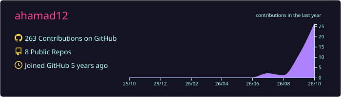
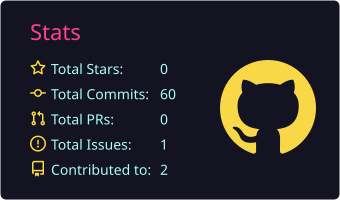
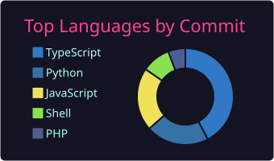
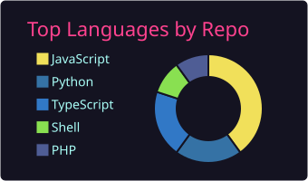

### 💫 About Me
💻 Full-stack & Mobile Developer  
⚛️ React / Next.js + Node.js / NestJS, with Python/FastAPI on the side  
🧠 Currently working on a personal project  
🏢 Software Engineer Intern @ Detech  
🎓 BSc Applied Mathematics and Computing, University of Jaffna

---

## 💻 Tech Stack
**Languages:**  

**Frontend & Mobile:**  

**Backend & APIs:**  

**Databases & Services:**  

**Tools & DevOps:**  

---

---

## 📊 GitHub Stats

  
  

  
  

---

## 🌐 Connect With Me

---
Thanks for stopping by! Let's **connect**, **collaborate**, and build something impactful 🚀
